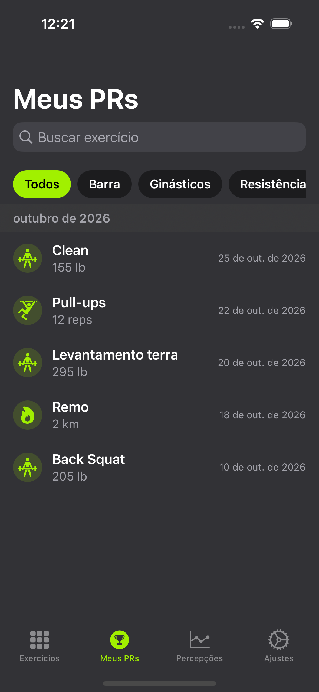
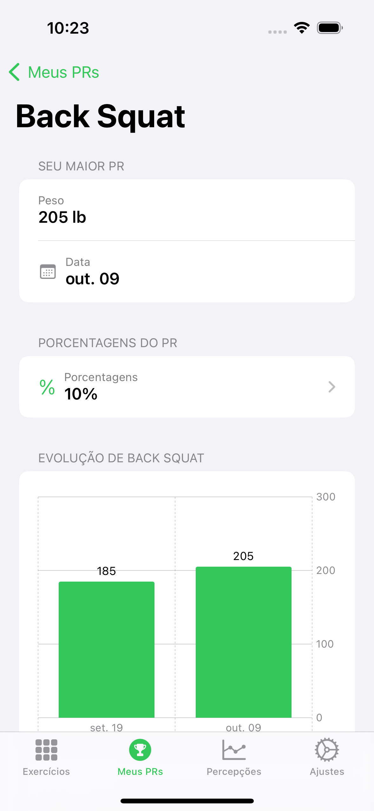
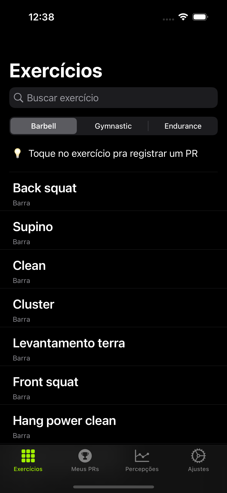
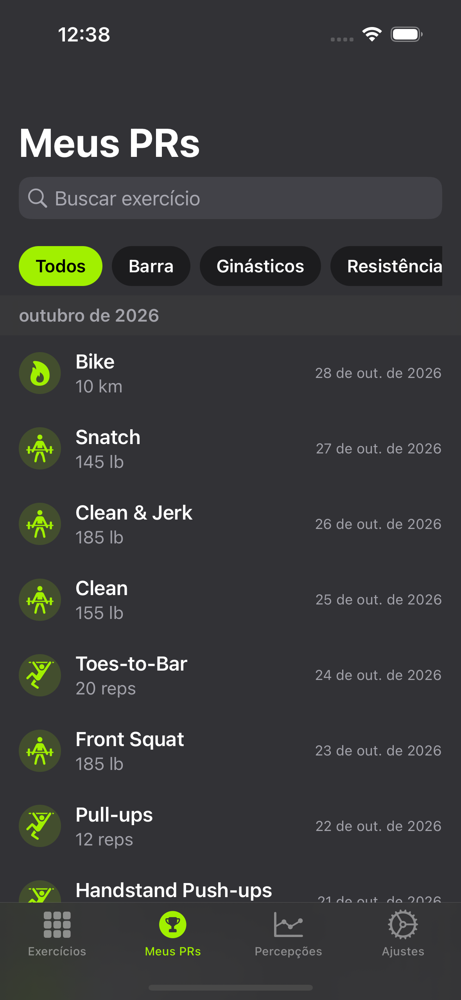
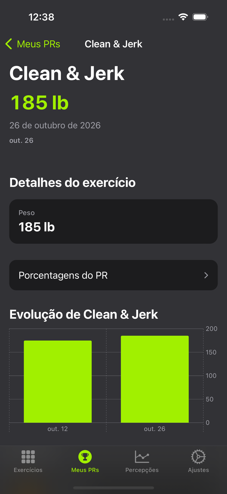
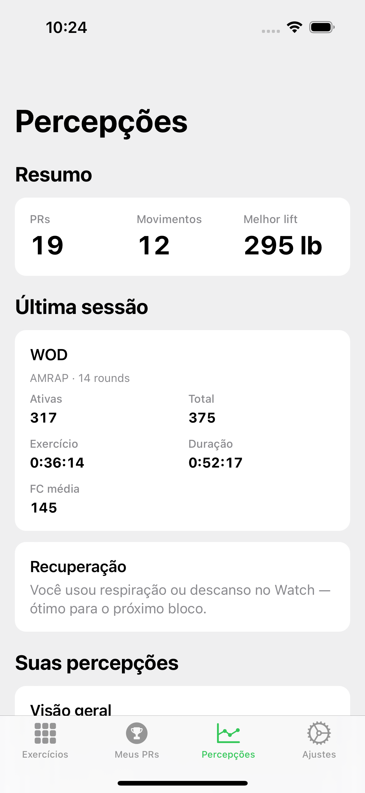
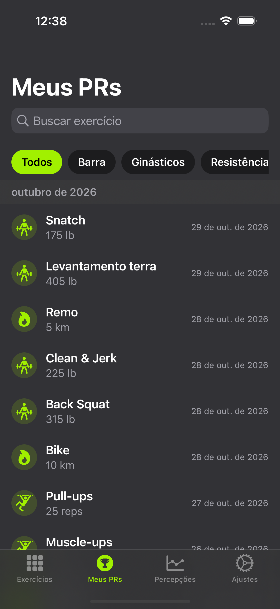
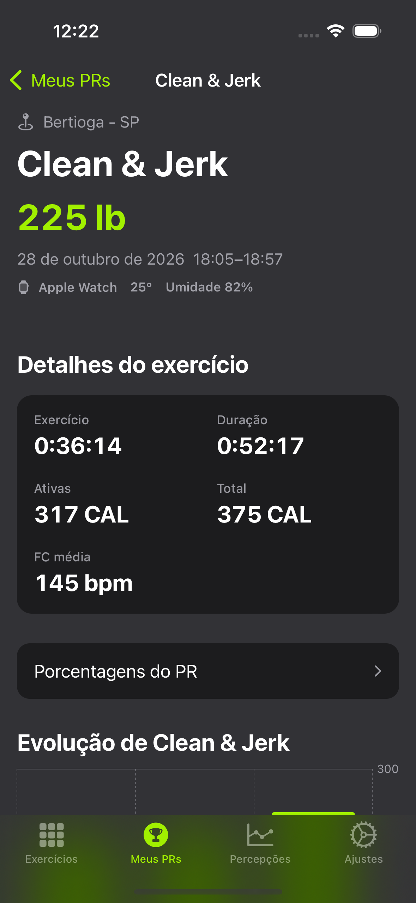
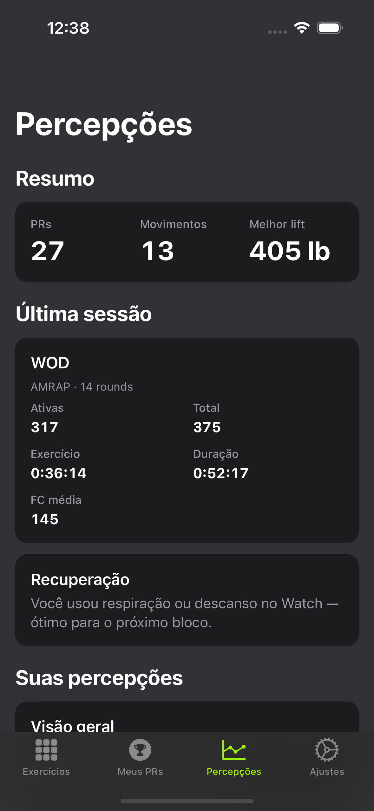
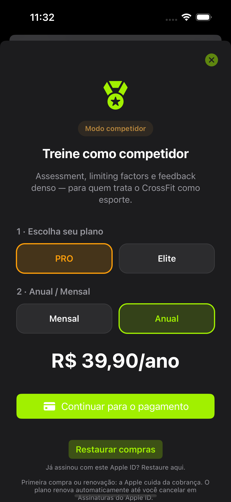

# CrossfitPR 🏋️

**Registre seus PRs, veja sua evolução e entenda quando vale a pena ir mais pesado.**

CrossfitPR é um app iOS para quem treina CrossFit e quer histórico claro de Personal Records — sem planilha. Quatro abas: exercícios → PRs → percepções → ajustes. O Apple Watch é companion de sessão (descanso + respiração), homologado junto ao valor principal do iPhone.

---

## Demo

<p align="center">
  
</p>

> Prints com **mocks cheios** (`freeTeaser` / `proRich` / `eliteRich`) — sem empty state. Galeria completa: [`docs/screenshots/REVIEW-TIERS.md`](docs/screenshots/REVIEW-TIERS.md). Gerar `.xcodeproj`: [`docs/XCODEGEN.md`](docs/XCODEGEN.md).

---

## Telas — Free / PRO / Elite (com dados)

### Free

<p align="center">
  
  
  
  
  
</p>

### PRO

<p align="center">
  
  
  
  
  
</p>

### Elite

<p align="center">
  
  
  
  
  
</p>

### Planos (sheet) — variante B (CPR-014)

Layout em passos: plano → período → preço → CTA. Review A/B/C: [`docs/screenshots/REVIEW-PAYWALL.md`](docs/screenshots/REVIEW-PAYWALL.md).

<p align="center">
  
</p>

### Apple Watch — companion de sessão

<p align="center">
  
  
  
</p>

Homologação por tela e dados Watch × iPhone: [`docs/WATCH-HOMOLOGATION.md`](docs/WATCH-HOMOLOGATION.md).

---

## O que o app faz de melhor

### iPhone — centro de valor

| Plano | Destaque |
|-------|----------|
| **Grátis** | PRs por categoria, histórico, teaser de Insights, kg/lb, iCloud |
| **PRO** | Coach IA, WorkoutEngine, gráficos, export — [`COACHING-INFERENCE.md`](docs/COACHING-INFERENCE.md) |
| **Elite** | Assessment + limiting factor + orçamento maior no coach — [`STOREKIT-PAYMENTS.md`](docs/STOREKIT-PAYMENTS.md) |

### Watch — sessão no pulso (não substitui Insights)

| Tela | Função | Dados |
|------|--------|--------|
| Sessão | Tip do bloco | Texto local (sem lista de PRs) |
| Descanso | Timer 1:30 + ring | Countdown; evento `rest` → iPhone |
| Respiração | Ciclo 4–4 + haptic | Fase inspire/expire; preferência local |

---

## Requisitos

| Item | Versão |
|------|--------|
| iOS | 16.0+ |
| watchOS | 9.0+ (companion) |
| Xcode | 14.2+ (Swift 5.7) ou Xcode 16+ |

---

## Rodar o projeto

```bash
git clone https://github.com/douglastaquary/CrossfitPRApp.git
cd CrossfitPRApp
chmod +x scripts/*.sh
./scripts/generate-xcodeproj.sh
open CrossfitPR.xcodeproj
```

**Xcode 14.2:** `./scripts/configure-spm-xcode14.sh` uma vez.

```bash
# Galeria Free/PRO/Elite (mocks cheios)
export CROSSFITPR_DOCS_ROOT="$(pwd)/docs"
xcodebuild test -scheme CrossfitPR -destination 'platform=iOS Simulator,name=iPhone 14 Pro' \
  -only-testing:CrossfitPRUITests/ReadmeScreenshotsUITests/testCaptureTierScreenGallery

# 3 variantes do paywall
xcodebuild test -scheme CrossfitPR -destination 'platform=iOS Simulator,name=iPhone 14 Pro' \
  -only-testing:CrossfitPRUITests/ReadmeScreenshotsUITests/testCapturePaywallVariants

# Watch
./scripts/boot-paired-watch.sh
./scripts/capture-watch-readme-screenshots.sh
```

**QA:** `./scripts/run-qa.sh` · pagamentos: [`docs/QA.md`](docs/QA.md) · CI: [`docs/CI.md`](docs/CI.md).

---

## Arquitetura

SPDD + monorepo SPM — [`docs/ARCHITECTURE.md`](docs/ARCHITECTURE.md), MV [`docs/MV-ARCHITECTURE.md`](docs/MV-ARCHITECTURE.md).

```
Packages/
├── Domain · Coaching · WorkoutEngine · Application
├── Insights · PROUpgrade · CrossfitPRWatch + WatchCompanion
└── Launch … Settings
```

### Roadmap

| ID | Tema | Status |
|----|------|--------|
| [CPR-007](spdd/stories/CPR-007-ai-crossfit-coach-pro.md) | Coach IA PRO | Shipped MVP |
| [CPR-008](spdd/stories/CPR-008-elite-tier.md) | Tier Elite | Shipped MVP |
| [CPR-009](spdd/stories/CPR-009-watch-companion.md) | Apple Watch | Homologação |
| [CPR-013](spdd/stories/CPR-013-pr-list-detail-fitness.md) | Meus PRs Fitness | Shipped |
| [CPR-014](spdd/prompt/CPR-014-20261029-[Design]-paywall-conversion-variants.md) | Paywall (variante B) | Shipped |

[`docs/PRODUCT-ROADMAP.md`](docs/PRODUCT-ROADMAP.md)

---

## Idiomas

Português (pt-BR) e inglês — `Packages/Localization/`.

---

## Licença

[MIT](LICENSE)

**Douglas Taquary** · [@douglastaquary](https://github.com/douglastaquary)

<p align="center"><i>Feito com carinho para a comunidade CrossFit</i></p>
