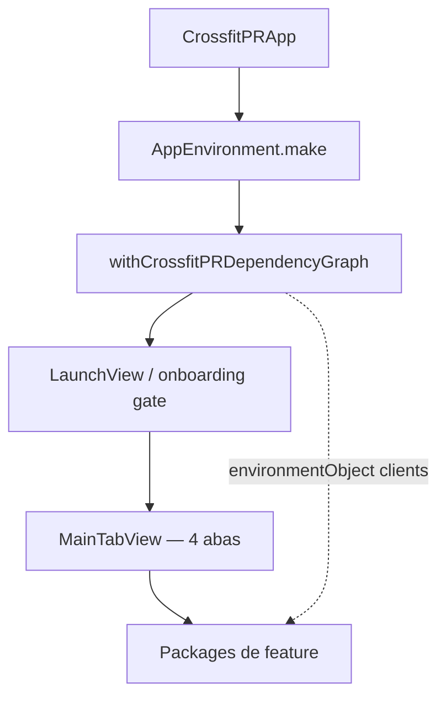

# CrossfitPR 🏋️

**Registre seus PRs, veja sua evolução e entenda quando vale a pena ir mais pesado.**

CrossfitPR é um app iOS feito para quem treina CrossFit e quer histórico claro de Personal Records — sem planilha, sem adivinhar se aquele snatch de ontem foi PR ou não. Quatro abas, fluxo direto: categorias → PRs → insights → ajustes.

---

## Demo

<p align="center">
  
</p>

> GIF e prints vêm de `docs/media/` e `docs/screenshots/` (capturas em **pt-BR**). Para atualizar após mudanças de UI, rode `./scripts/capture-readme-media-auto.sh` — o script escolhe simulador via `scripts/pick-ios-simulator.rb` (mesma lógica do CI). Xcode 14.2: `./scripts/configure-spm-xcode14.sh` na primeira vez.

---

## Telas

<p align="center">
  
  
  
  
  
  
</p>

---

## O que você ganha

### Grátis — registrar e acompanhar o básico

- **PRs por categoria** — Barbell, Gymnastic, Endurance e mais
- **Histórico** — lista dos seus registros com detalhe por exercício
- **Insights essenciais** — visão inicial da evolução (teaser do que o PRO desbloqueia)
- **Unidade kg ou lb** — escolha em Ajustes
- **Offline-first** — dados salvos no aparelho; sync com iCloud quando disponível
- **Onboarding rápido** — splash + boas-vindas, já cai nas tabs

### CrossfitPR PRO — menos que um café por mês ☕

O PRO é para quem quer **interpretação**, não só números na tela:

| Benefício | Por que importa |
|-----------|-----------------|
| **Análises inteligentes dos treinos** | Padrões no seu histórico explicados em linguagem clara — o que melhorou, o que travou |
| **Motor de treino (WorkoutEngine)** | Estagnação, tendências e gatilhos para destravar PRs |
| **Gráficos de progressão** | Evolução por movimento, não só o último valor |
| **Metas no seu ritmo** | Recomendações alinhadas ao que você já registrou |
| **Exportar histórico** | Leve seus dados para onde quiser |

#### Hoje vs coach IA (honesto)

| | **Hoje (shipped)** | **Próximo (CPR-007)** |
|---|-------------------|------------------------|
| Free | WorkoutEngine — heurísticas locais, teaser PRO | Igual — **sem LLM** |
| PRO | Rankings, gráficos, análises WorkoutEngine na UI; card coach com **adapters mock** até inferência real | Coach CrossFit: **on-device** quando disponível, **cloud** como fallback; contexto compacto + cache |

Interpretar meses de PRs (volume, platôs, movimentos diferentes) tem **custo de inferência** — tokens e pipeline. Parte do valor PRO cobre isso: dados agregados, sem planilha, linguagem de coach.

> **Transparência:** IA generativa completa ainda está em rollout ([`CPR-007`](spdd/stories/CPR-007-ai-crossfit-coach-pro.md)). Roadmap público: [`docs/PRODUCT-ROADMAP.md`](docs/PRODUCT-ROADMAP.md) (Elite CPR-008, Apple Watch CPR-009).

---

## Requisitos

| Item | Versão |
|------|--------|
| iOS | 16.0+ |
| Xcode | 14.2+ (Swift 5.7) ou Xcode 16+ |
| Conta Apple Developer | Recomendada para CloudKit / TestFlight |

---

## Rodar o projeto

```bash
git clone https://github.com/douglastaquary/CrossfitPR.git
cd CrossfitPR
open CrossfitPR.xcodeproj
```

1. Em **Signing & Capabilities**, escolha seu Team (`com.douglast.CrossfitPR`).
2. Simulador **iPhone 14 Pro** (ou superior) → `⌘R`.

**Linha de comando:**

```bash
xcodebuild -scheme CrossfitPR \
  -destination 'platform=iOS Simulator,name=iPhone 14 Pro' build

cd Packages/Domain && swift test
cd ../WorkoutEngine && swift test
```

**Atualizar GIF e screenshots do README:**

```bash
./scripts/configure-spm-xcode14.sh   # Xcode 14.2 — aponta SPM local file URL
./scripts/capture-readme-media-auto.sh
```

**QA (CI):** `./scripts/run-qa.sh` — UI tests de localização pt/en. Ver [`docs/QA.md`](docs/QA.md).

**SPM / Xcode 14.2:** pacote local na raiz (`Package.swift`). Rode `./scripts/configure-spm-xcode14.sh` após clone/pull; **não commite** o `project.pbxproj` gerado (file URL absoluta).

**CI (Xcode/iOS recentes):** GitHub Actions roda [`scripts/ci-modern.sh`](scripts/ci-modern.sh) em `macos-15` — ver [`docs/CI.md`](docs/CI.md). Antes do push: `git checkout -- CrossfitPR.xcodeproj/project.pbxproj` se usou o script 14.2.

---

## Arquitetura e como o app é montado

Desenvolvimento guiado por [SPDD](https://martinfowler.com/articles/structured-prompt-driven/) — intenção no canvas, código rastreável. Detalhes: [`docs/ARCHITECTURE.md`](docs/ARCHITECTURE.md), UI **MV** [`docs/MV-ARCHITECTURE.md`](docs/MV-ARCHITECTURE.md), wiring [`docs/APP-WIRING.md`](docs/APP-WIRING.md), CI [`docs/CI.md`](docs/CI.md).



```
CrossfitPR/              # @main, tabs, AppDependencyGraph
Package.swift            # Monorepo SPM na raiz
Packages/
├── Domain               # Entidades, ports (incl. coaching)
├── Coaching             # Snapshot, TokenBudget, adapters (CPR-007)
├── Persistence          # JSON + CloudKit
├── Subscription         # StoreKit 2
├── WorkoutEngine        # Heurísticas Free/PRO
├── Application          # Clients + composition root
├── Localization         # Strings + AppDesign
├── SharedUI             # Componentes
└── Launch … Settings    # Features por aba
```

**Padrões:** SwiftUI **MV** (sem ViewModels); clients via `@EnvironmentObject`; copy/cores `Strings.*` / `AppDesign.*`.

### Curiosidades do projeto

- **SPDD** — features rastreáveis em `spdd/prompt/` (canvas REASONS).
- **Monorepo SPM** na raiz — um `Package.swift` para Xcode 14+ e CI moderno.
- **Offline-first** — JSON local; CloudKit best-effort.
- **QA pt/en no CI** — `AppLocalizationQATests` + catálogo de exercícios.
- **Review arquitetural advisory** em PRs (MV, wiring, SwiftLint).
- **Foco CrossFit** — PRs por modalidade (barbell, ginástico, resistência), não “gym genérico”.

### Roadmap (planned)

| ID | Tema | Status |
|----|------|--------|
| [CPR-007](spdd/stories/CPR-007-ai-crossfit-coach-pro.md) | Coach IA PRO | Canvas + infra mock |
| [CPR-008](spdd/stories/CPR-008-elite-tier.md) | Tier Elite | SPDD |
| [CPR-009](spdd/stories/CPR-009-watch-companion.md) | Apple Watch | SPDD |

Visão de produto: [`docs/PRODUCT-ROADMAP.md`](docs/PRODUCT-ROADMAP.md).

---

## Idiomas

Português (pt-BR) e inglês — `Packages/Localization/Sources/Localization/Resources/`.

---

## Contribuir

1. Fork → branch `feature/...`
2. Workflow SPDD: story → analysis → canvas → código (ID `CPR-NNN`)
3. Pull Request com test plan

---

## Licença

[MIT](LICENSE)

---

**Douglas Taquary** · [@douglastaquary](https://github.com/douglastaquary)

<p align="center"><i>Feito com carinho para a comunidade CrossFit</i></p>
