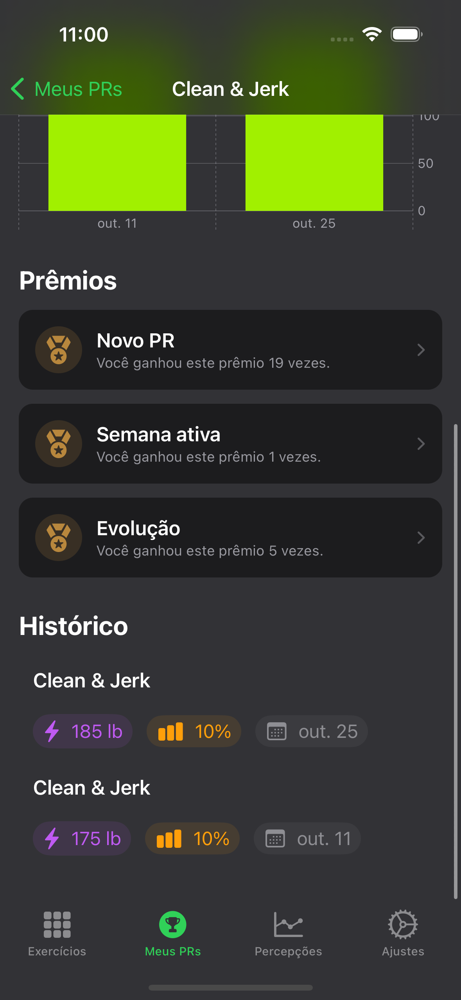
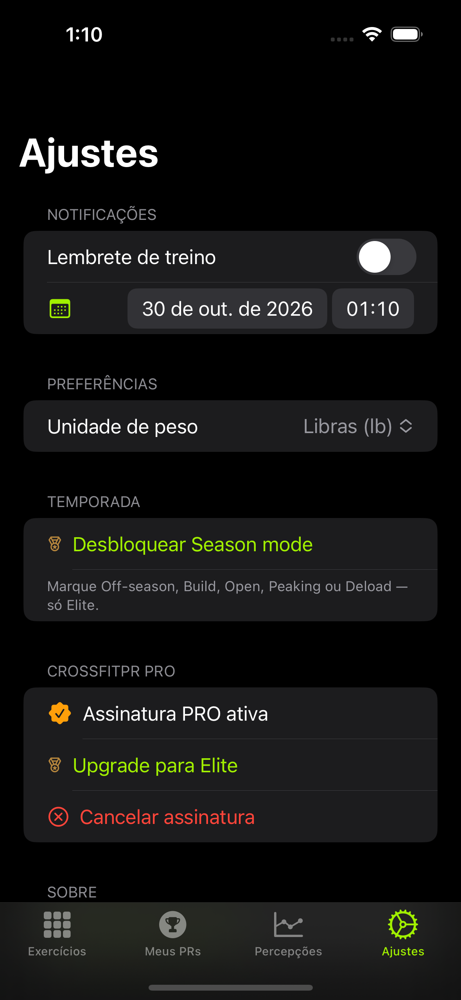
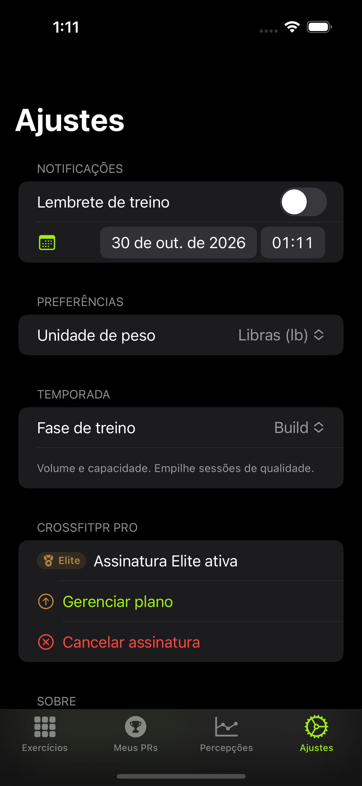
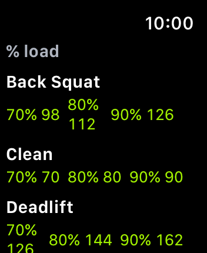

# CrossfitPR 🏋️

**Registre seus PRs, veja sua evolução e entenda quando vale a pena ir mais pesado.**

CrossfitPR é um app iOS para quem treina CrossFit e quer histórico claro de Personal Records — sem planilha. Quatro abas: exercícios → PRs → percepções → ajustes. O Apple Watch é companion de WOD (timer AMRAP/EMOM/FT, % load, descanso, cool-down); o **valor principal fica no iPhone** (PRs + Insights + planos).

---

## Demo

<p align="center">
  
</p>

> Prints com **mocks cheios** (`freeTeaser` / `proRich` / `eliteRich`) — **sem empty state**. Fonte: `docs/screenshots/review/{free,pro,elite}/` · índice [`REVIEW-TIERS.md`](docs/screenshots/REVIEW-TIERS.md). Gerar `.xcodeproj`: [`docs/XCODEGEN.md`](docs/XCODEGEN.md).

---

## Telas — Free / PRO / Elite (com dados)

### Meus PRs — lista e detalhe (CPR-013 Fitness)

Layout atual: categorias sticky, cards com peso/data, detalhe com gráfico, histórico, sessão Watch e prêmios. Seeds `proRich` / `eliteRich`.

<p align="center">
  
  
  
</p>

Light/dark: [`REVIEW-PR-FITNESS.md`](docs/screenshots/REVIEW-PR-FITNESS.md).

### Free

<p align="center">
  
  
  
  
  
</p>

| Tela | O que mostra (dados) |
|------|----------------------|
| Exercícios | Categorias de movimentos |
| Meus PRs | Lista Fitness (seed `freeTeaser`) |
| Detalhe | Gráfico, histórico, sessão, prêmios |
| Percepções | Teaser + insight real + CTA PRO |
| Ajustes | Unidade kg/lb, unlock PRO |

### PRO

<p align="center">
  
  
  
  
  
  
</p>

| Tela | O que mostra (dados) |
|------|----------------------|
| Exercícios / Meus PRs / Detalhe | Layout Fitness, seed `proRich` |
| Percepções (topo) | Resumo, sessão, métricas |
| Percepções (meio) | Coach IA + WorkoutEngine |
| Ajustes | Tier PRO ativo |

### Elite

<p align="center">
  
  
  
  
  
  
</p>

| Tela | O que mostra (dados) |
|------|----------------------|
| Exercícios / Meus PRs / Detalhe | Layout Fitness, seed `eliteRich` |
| Percepções | Tudo do PRO + **assessment** + **limiting factor** (selo Elite) |
| Ajustes | Tier Elite ativo (selo) |

### Planos (sheet) — variante B

<p align="center">
  
</p>

Passos: plano → período → preço → CTA · tabela Free/PRO/Elite. Detalhe: [`REVIEW-PAYWALL.md`](docs/screenshots/REVIEW-PAYWALL.md).

---

## Apple Watch — companion de sessão (WOD)

<p align="center">
  
  
  
  
</p>

Homologação: [`docs/WATCH-HOMOLOGATION.md`](docs/WATCH-HOMOLOGATION.md).

### Resumo por tela

| Tela Watch | Função | Dados exibidos | Envia ao iPhone? |
|------------|--------|----------------|------------------|
| **Sessão** | Timer AMRAP / EMOM / For Time + tip | `mm:ss` · modo · tip WOD | Eventos timer → coach |
| **% load** | 70/80/90% de 1RM (até 3 lifts) | Nome · % · valor | Contexto WC (fixture se offline) |
| **Descanso** | Timer 1:30 entre séries/rounds | `mm:ss` · ring · “entre rounds” | Sim — evento `rest` (WC) |
| **Cool-down** | Respiração 4–4 pós-esforço | Fase · anel · haptic opt-in | Preferência local |

### Detalhe das funcionalidades

1. **Sessão** — timer de metcon no pulso (Compete / Mayhem). Sem LLM no Watch.
2. **% load** — carga rápida a partir dos PRs do iPhone (ou fixture).
3. **Descanso** — intervalo entre rounds; ao fim grava `rest` → coach no iPhone.
4. **Cool-down** — reset 4s/4s após esforço; haptic opt-in.

### Dados: Watch × app iPhone

| Domínio | Watch | iPhone |
|---------|-------|--------|
| PRs / histórico / detalhe | % load | Exercícios, Meus PRs, Record Detail, Share Card |
| Insights / Coach / Elite | — | Hub (teaser Free · benchmarks PRO · Season + assessment Elite) |
| Assinatura | — | Ajustes + sheet de planos |
| Sessão no box | Timer + % + rest + cool-down | Eventos WC → `sessionEvents` no coach |
| Health / CAL / FC | — | Insights hub (quando autorizado) |

O iPhone é o centro de valor. O Watch **não** substitui Insights nem o histórico de PRs.

---

## O que o app faz de melhor

| Plano | Destaque |
|-------|----------|
| **Grátis** | PRs, histórico, celebração + Share Card simples, teaser Insights, kg/lb, iCloud |
| **PRO** | Coach IA, benchmarks Girls/Heroes/Open, gráficos, Share branded — [`COACHING-INFERENCE.md`](docs/COACHING-INFERENCE.md) |
| **Elite** | Season mode + assessment + limiting + coach 180d — [`STOREKIT-PAYMENTS.md`](docs/STOREKIT-PAYMENTS.md) |

---

## Requisitos

| Item | Versão |
|------|--------|
| iOS | 16.0+ |
| watchOS | 9.0+ (companion) |
| Xcode | 14.2+ (Swift 5.7) ou Xcode 16+ |

---

## Rodar o projeto

```bash
git clone https://github.com/douglastaquary/CrossfitPRApp.git
cd CrossfitPRApp
chmod +x scripts/*.sh
./scripts/generate-xcodeproj.sh
open CrossfitPR.xcodeproj
```

**Xcode 14.2:** `./scripts/configure-spm-xcode14.sh` uma vez.

```bash
# Galeria Free/PRO/Elite (mocks cheios)
export CROSSFITPR_DOCS_ROOT="$(pwd)/docs"
xcodebuild test -scheme CrossfitPR -destination 'platform=iOS Simulator,name=iPhone 14 Pro' \
  -only-testing:CrossfitPRUITests/ReadmeScreenshotsUITests/testCaptureTierScreenGallery

# Watch
./scripts/boot-paired-watch.sh
./scripts/capture-watch-readme-screenshots.sh
```

**QA:** `./scripts/run-qa.sh` · CI: [`docs/CI.md`](docs/CI.md).

---

## Arquitetura

SPDD + monorepo SPM — [`docs/ARCHITECTURE.md`](docs/ARCHITECTURE.md), MV [`docs/MV-ARCHITECTURE.md`](docs/MV-ARCHITECTURE.md).

```
Packages/
├── Domain · Coaching · WorkoutEngine · Application
├── Insights · PROUpgrade · CrossfitPRWatch + WatchCompanion
└── Launch … Settings
```

### Roadmap

| ID | Tema | Status |
|----|------|--------|
| [CPR-007](spdd/stories/CPR-007-ai-crossfit-coach-pro.md) | Coach IA PRO | Shipped MVP |
| [CPR-008](spdd/stories/CPR-008-elite-tier.md) | Tier Elite | Shipped MVP |
| [CPR-009](spdd/stories/CPR-009-watch-companion.md) | Apple Watch | Homologação |
| [CPR-013](spdd/stories/CPR-013-pr-list-detail-fitness.md) | Meus PRs Fitness | Shipped |
| [CPR-014](spdd/prompt/CPR-014-20261029-[Design]-paywall-conversion-variants.md) | Paywall (variante B) | Shipped |
| [CPR-015](spdd/stories/CPR-015-season-mode.md) | Season mode Elite | Shipped MVP |
| [CPR-016](spdd/stories/CPR-016-watch-wod-timer.md) | Watch timer + % load | Shipped MVP |
| [CPR-017](spdd/stories/CPR-017-pr-share-card.md) | PR Share Card | Shipped MVP |
| [CPR-018](spdd/stories/CPR-018-benchmarks-pack.md) | Benchmarks pack | Shipped MVP |

[`docs/PRODUCT-ROADMAP.md`](docs/PRODUCT-ROADMAP.md)

---

## Idiomas

Português (pt-BR) e inglês — `Packages/Localization/`.

---

## Licença

[MIT](LICENSE)

**Douglas Taquary** · [@douglastaquary](https://github.com/douglastaquary)

<p align="center"><i>Feito com carinho para a comunidade CrossFit</i></p>
