# CrossfitPR 🏋️

**Registre seus PRs, veja sua evolução e entenda quando vale a pena ir mais pesado.**

CrossfitPR é um app iOS feito para quem treina CrossFit e quer histórico claro de Personal Records — sem planilha, sem adivinhar se aquele snatch de ontem foi PR ou não. Quatro abas, fluxo direto: categorias → PRs → insights → ajustes.

---

## Demo

<p align="center">
  
</p>

> GIF e prints vêm de `docs/media/` e `docs/screenshots/` (capturas em **pt-BR**). Atualizar: `./scripts/capture-readme-media-auto.sh`. O `.xcodeproj` **não está no git** — veja [`docs/XCODEGEN.md`](docs/XCODEGEN.md).

---

## Telas — iPhone

<p align="center">
  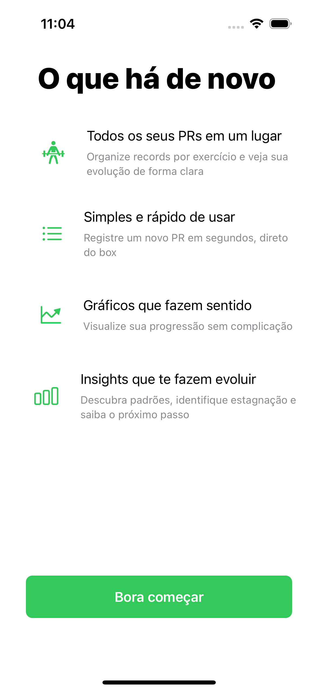
  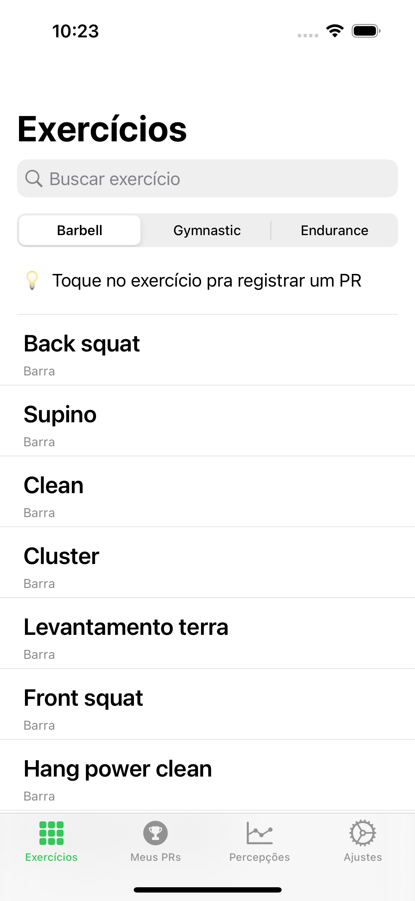
  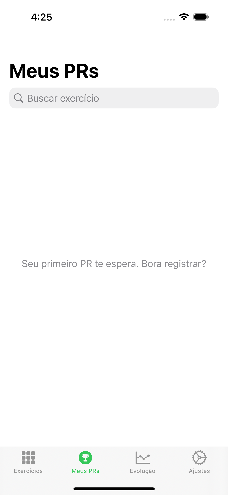
  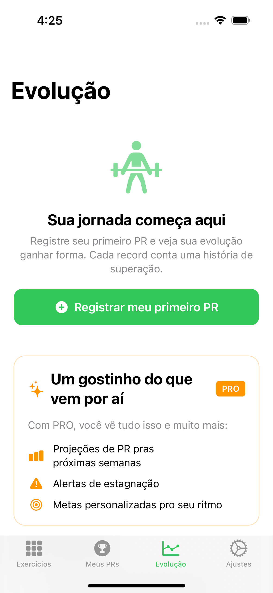
  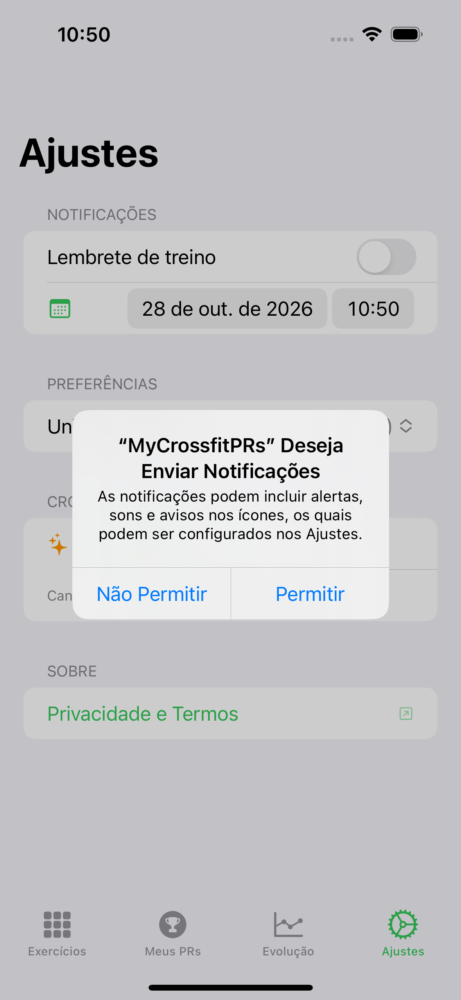
</p>

### PRO, Elite e paywall

<p align="center">
  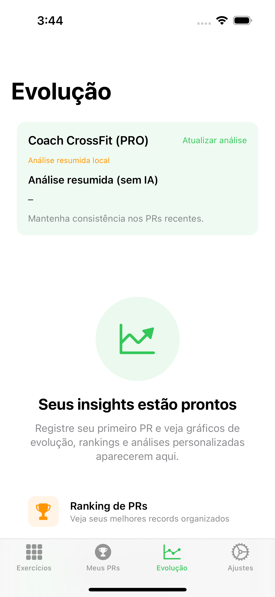
  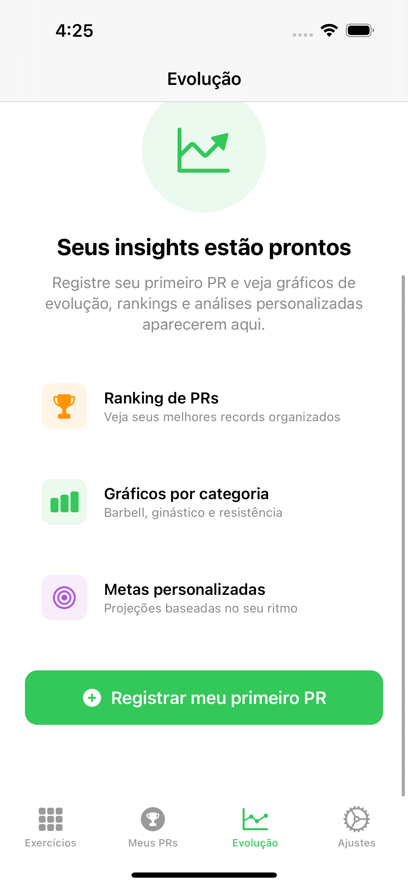
  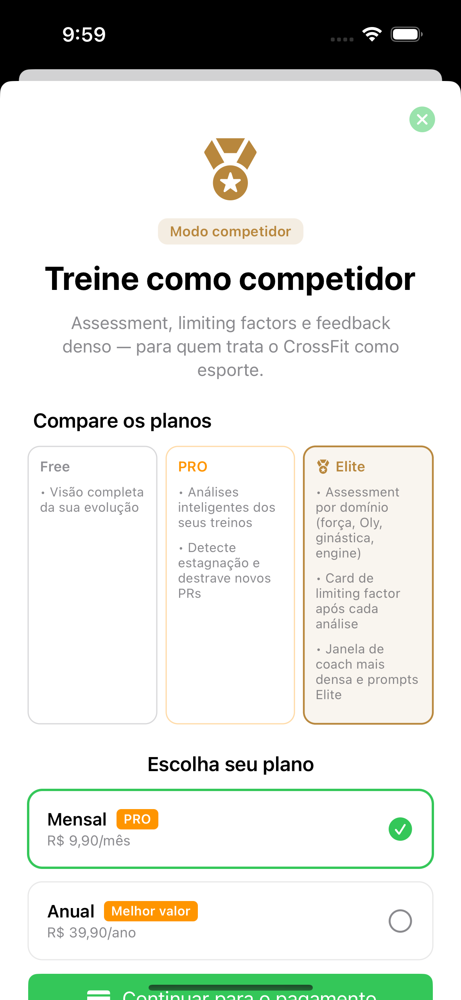
</p>

### Apple Watch (POC CPR-009)

<p align="center">
  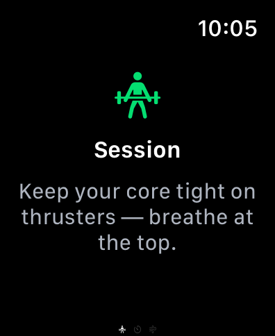
  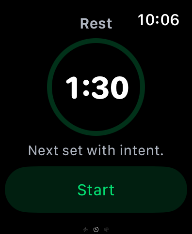
  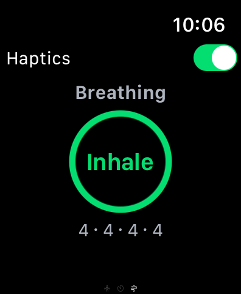
</p>

> Target **CrossfitPRWatch** (watchOS 9+) — sync via WatchConnectivity para o coach no iPhone. Capturas: [`docs/WATCH-POC.md`](docs/WATCH-POC.md).

---

## O que você ganha

### Grátis — registrar e acompanhar o básico

- **PRs por categoria** — Barbell, Gymnastic, Endurance e mais
- **Histórico** — lista dos seus registros com detalhe por exercício
- **Insights essenciais** — visão inicial da evolução (teaser do que o PRO desbloqueia)
- **Unidade kg ou lb** — escolha em Ajustes
- **Offline-first** — dados salvos no aparelho; sync com iCloud quando disponível
- **Onboarding rápido** — splash + boas-vindas, já cai nas tabs

### CrossfitPR PRO — menos que um café por mês ☕

O PRO é para quem quer **interpretação**, não só números na tela:

| Benefício | Por que importa |
|-----------|-----------------|
| **Coach IA** | On-device (iOS 26+) → OpenAI → resumo local — [`COACHING-INFERENCE.md`](docs/COACHING-INFERENCE.md) |
| **WorkoutEngine** | Estagnação, tendências e gatilhos para destravar PRs |
| **Gráficos de progressão** | Evolução por movimento, não só o último valor |
| **Exportar histórico** | Leve seus dados para onde quiser |

### Elite — modo competidor (CPR-008)

- **Assessment** por domínio e **limiting factor**
- Paywall **multi-plano** (PRO + Elite) — [`STOREKIT-PAYMENTS.md`](docs/STOREKIT-PAYMENTS.md)
- Orçamento de tokens maior no coach (tier Elite)

---

## Requisitos

| Item | Versão |
|------|--------|
| iOS | 16.0+ |
| Xcode | 14.2+ (Swift 5.7) ou Xcode 16+ |
| Conta Apple Developer | Recomendada para CloudKit / TestFlight |

---

## Rodar o projeto

```bash
git clone https://github.com/douglastaquary/CrossfitPRApp.git
cd CrossfitPRApp
chmod +x scripts/*.sh
./scripts/generate-xcodeproj.sh    # project.yml → CrossfitPR.xcodeproj (obrigatório)
open CrossfitPR.xcodeproj
```

**Xcode 14.2:** depois de gerar, rode `./scripts/configure-spm-xcode14.sh` uma vez (SPM local na sua máquina).

1. Em **Signing & Capabilities**, escolha seu Team (`com.douglast.CrossfitPR`).
2. Simulador **iPhone 14 Pro** (ou superior) → `⌘R`.

Alterou targets, Watch ou deps no [`project.yml`](project.yml)? Regenere:

```bash
REGENERATE_XCODEPROJ=1 ./scripts/generate-xcodeproj.sh
```

Detalhes: [`docs/XCODEGEN.md`](docs/XCODEGEN.md).

**Linha de comando:**

```bash
./scripts/ensure-xcodeproj.sh
xcodebuild -scheme CrossfitPR -project CrossfitPR.xcodeproj \
  -destination 'platform=iOS Simulator,name=iPhone 14 Pro' build

cd Packages/Domain && swift test
```

**Atualizar GIF e screenshots do README:**

```bash
./scripts/generate-xcodeproj.sh
./scripts/configure-spm-xcode14.sh   # só Xcode 14.2
./scripts/capture-readme-media-auto.sh
```

**QA:** `./scripts/run-qa.sh` · pagamentos: `./scripts/test-payments.sh` — [`docs/QA.md`](docs/QA.md).

**CI (Xcode recente):** [`scripts/ci-modern.sh`](scripts/ci-modern.sh) — [`docs/CI.md`](docs/CI.md).

---

## Arquitetura

SPDD + monorepo SPM — [`docs/ARCHITECTURE.md`](docs/ARCHITECTURE.md), MV [`docs/MV-ARCHITECTURE.md`](docs/MV-ARCHITECTURE.md).

```
Packages/
├── Domain · Coaching · WorkoutEngine · Application
├── Insights · PROUpgrade · CrossfitPRWatch + WatchCompanion
└── Launch … Settings
```

### Roadmap

| ID | Tema | Status |
|----|------|--------|
| [CPR-007](spdd/stories/CPR-007-ai-crossfit-coach-pro.md) | Coach IA PRO | Shipped MVP |
| [CPR-008](spdd/stories/CPR-008-elite-tier.md) | Tier Elite | Em progresso |
| [CPR-009](spdd/stories/CPR-009-watch-companion.md) | Apple Watch | Target watchOS (scaffold) |

[`docs/PRODUCT-ROADMAP.md`](docs/PRODUCT-ROADMAP.md)

---

## Idiomas

Português (pt-BR) e inglês — `Packages/Localization/`.

---

## Licença

[MIT](LICENSE)

**Douglas Taquary** · [@douglastaquary](https://github.com/douglastaquary)

<p align="center"><i>Feito com carinho para a comunidade CrossFit</i></p>
