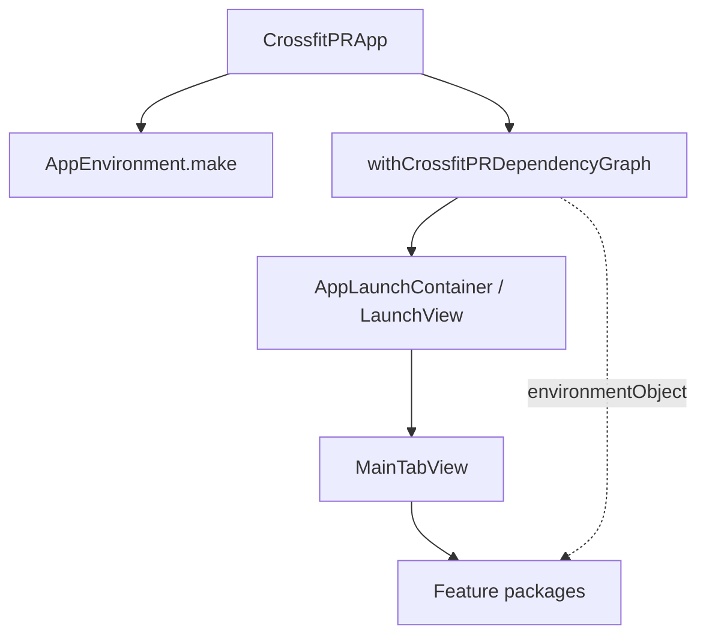

# App wiring — CrossfitPR

Padrão oficial de **shell** e **injeção de dependências** na UI, complementar a [`MV-ARCHITECTURE.md`](MV-ARCHITECTURE.md) e [`ARCHITECTURE.md`](ARCHITECTURE.md).

## Princípios

1. **Composition root único** — `AppEnvironment.make()` apenas em `CrossfitPRApp`.
2. **Grafo global no root** — modifier `withCrossfitPRDependencyGraph` concentra `.environmentObject` e bootstrap.
3. **Shell em camadas** — splash → launch gate → tabs; features não montam o app.
4. **Clients na borda** — features não acessam Persistence/StoreKit diretamente.

## Fluxo

## Arquivos

| Arquivo | Responsabilidade |
|---------|------------------|
| [`CrossfitPR/CrossfitPRApp.swift`](../CrossfitPR/CrossfitPRApp.swift) | `@main`, holder do environment |
| [`CrossfitPR/AppDependencyGraph.swift`](../CrossfitPR/AppDependencyGraph.swift) | Modifier de wiring |
| [`CrossfitPR/RootView.swift`](../CrossfitPR/RootView.swift) | Tab shell |
| [`Packages/Application/.../AppEnvironment.swift`](../Packages/Application/Sources/Application/AppEnvironment.swift) | Montagem de clients |

## Agents / skills

- Skill: [`.cursor/skills/app-wiring/SKILL.md`](../.cursor/skills/app-wiring/SKILL.md)
- Detalhe: [`.cursor/skills/app-wiring/references/app-wiring-crossfitpr.md`](../.cursor/skills/app-wiring/references/app-wiring-crossfitpr.md)

## CI

Review de PR inclui categoria **Wiring** (ver [`CI.md`](CI.md)).
