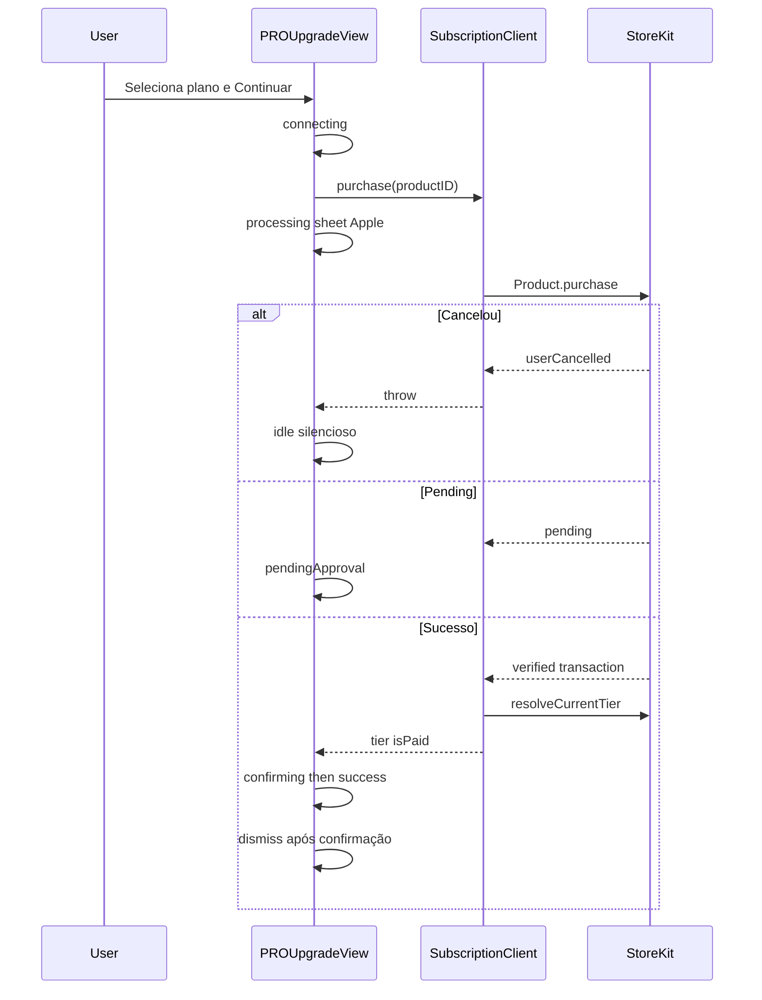

# StoreKit — Pagamentos PRO / Elite

Guia de produto e engenharia para o fluxo de assinatura no CrossfitPR (CPR-002 + CPR-008).  
Objetivo: processo **simples, intuitivo e claro** — primeira compra ou renovação — com feedback em cada etapa até o tier estar registrado **no cliente e na App Store**.

Produtos Elite no App Store Connect: [`APP-STORE-CONNECT-ELITE.md`](APP-STORE-CONNECT-ELITE.md).

## Preocupações (o que não pode falhar em silêncio)

| Preocupação | Risco | Mitigação no app |
|-------------|-------|------------------|
| Sheet Apple abre e o usuário acha que “travou” | Abandono | Estado `processing` com copy “Aguardando a App Store…” |
| Compra OK na Apple, app ainda Free | Feature paga bloqueada | Após `purchase`, `resolveCurrentTier()` e merge; listener `Transaction.updates` |
| Usuário cancela o sheet | Erro assustador | `userCancelled` → volta ao idle **sem** overlay de erro |
| Assinatura `pending` (Ask to Buy / revisão) | Confusão | Estado `pending` + mensagem acionável; listener atualiza depois |
| Renovação automática sem contexto | Surpresa na fatura | Copy de compromisso: renovação + cancelamento a qualquer momento |
| Restaurar em outro device | “Já paguei” | Botão Restaurar + feedback “nada encontrado” vs “assinatura ativa” |
| Produtos fora do ar / sandbox | Paywall vazio | Empty state + Retry; erros `productUnavailable` claros |
| PRO vs Elite (grupos distintos) | Tier errado | `SubscriptionCatalog.tier(forProductID:)` + Elite tem prioridade no resolve |
| Fake progress (sleeps) | Confiança baixa | Estados só mudam com eventos reais StoreKit |

## Fluxo (primeira compra ou upgrade)



## Renovação / recorrente

- A cobrança recorrente é da **App Store** (período do produto mensal/anual).
- O app **não** reabre o sheet a cada renovação.
- Em launch / foreground: `refreshStatus()` + `observeTransactionUpdates()` mantêm `currentTier` alinhado.
- UI de Settings mostra “assinatura ativa” (PRO ou Elite); cancelamento orienta Settings da Apple quando aplicável.

## Estados de UX (overlay)

| Estado | Quando | Mensagem ao usuário |
|--------|--------|---------------------|
| `connecting` | Início do tap | Conectando à App Store… |
| `processing` | Chamada `purchase` em andamento | Confirme o pagamento na App Store… |
| `confirming` | Transaction OK; sync entitlements | Registrando no app e na App Store… |
| `success` | Tier `isPaid` confirmado | Pronto — assinatura ativa |
| `pending` | Ask to Buy / pending | Aguardando aprovação da App Store |
| `error` | Falha recuperável | Título + causa + Tentar de novo |
| cancel | `userCancelled` | Sem erro; volta à seleção de plano |

## Matriz de erros

| `SubscriptionError` | Copy (intenção) | Ação |
|---------------------|-----------------|------|
| `userCancelled` | (nenhuma) | Idle |
| `pending` | Aguardando confirmação | Esperar / fechar e voltar depois |
| `productUnavailable` | Plano indisponível agora | Retry load products |
| `purchaseFailed` | Não concluímos o pagamento | Retry / checar rede / método de pagamento |

## Dual registration (cliente ↔ StoreKit)

Fonte da verdade: **entitlements** (`Transaction.currentEntitlements`).

1. `store.purchase` → transaction verified + `finish()`
2. `store.resolveCurrentTier()` → lê entitlements
3. `SubscriptionClient.currentTier` = merge (compra + entitlements; Elite > PRO)
4. `Transaction.updates` → refresh contínuo (renovação, family, pending → active)

Se entitlements atrasarem após compra bem-sucedida, o app confia no tier retornado pela compra até o próximo refresh.

## Superfícies de UI

- [`PROUpgradeView`](../Packages/PROUpgrade/Sources/PROUpgrade/PROUpgradeView.swift) — seleção, progresso, erro, sucesso, restaurar
- Settings — status ativo + upgrade Elite + cancelar (local)
- `Products.storekit` — sandbox local; produção exige App Store Connect

## Automação (reutilizável)

No **simulador**, o app usa `MockSubscriptionStore` por padrão (determinístico no CI).  
`Products.storekit` está no scheme para validação manual / `UITEST_USE_STOREKIT=1`.

| Camada | O quê | Como rodar |
|--------|-------|------------|
| Unit | `PaymentFlowTests` — succeed / cancel / fail / pending / restore | `cd Packages/Subscription && swift test --filter PaymentFlow` |
| UI | `PaymentFlowUITests` — compra, cancel, restore vazio, fail | `./scripts/test-payments.sh` |
| CI | Ambos | `scripts/ci-modern.sh` inclui PaymentFlow UI + `swift test` Subscription |

### Launch env (UI)

| Key | Valores | Efeito |
|-----|---------|--------|
| `UITEST_SKIP_SPLASH=1` | — | Modo UI test |
| `UITEST_SKIP_ONBOARDING=1` | — | Pula onboarding |
| `UITEST_SUBSCRIPTION_TIER` | `free` \| `pro` \| `elite` | Tier inicial do mock |
| `UITEST_PURCHASE_BEHAVIOR` | `succeed` \| `cancel` \| `fail` \| `pending` | Resultado da próxima compra |
| `UITEST_USE_STOREKIT=1` | — | Usa `StoreKitSubscriptionStore` + Products.storekit |

### Accessibility IDs (pagamento)

`pro.upgrade.close`, `pro.upgrade.scroll`, `pro.upgrade.continue.payment`, `pro.upgrade.restore`, `pro.upgrade.product.proMonthly` / `proAnnual` / `eliteMonthly` / `eliteAnnual`, `pro.upgrade.success.title`, `pro.upgrade.error.title`, `pro.upgrade.error.retry`, `pro.upgrade.processing.overlay`

```bash
./scripts/test-payments.sh
```

## Checklist de QA

### Automatizado (CI / script)

- [x] Compra PRO mock → sucesso + Insights coach
- [x] Cancel mock → sem erro vermelho
- [x] Restore sem compra → erro claro + retry
- [x] Fail mock → erro acionável
- [x] Unit PaymentFlow (succeed/cancel/fail/pending/restore)

### Manual (Products.storekit)

- [ ] Scheme Run com StoreKit Configuration = `Products.storekit`
- [ ] Ou `UITEST_USE_STOREKIT=1` + sheet Apple no simulador
- [ ] Cancelar sheet Apple → Free, sem tela vermelha
- [ ] Relançar app após compra → tier via entitlements

## Refs

- Canvas CPR-002 / CPR-008  
- `SubscriptionCatalog`, `StoreKitSubscriptionStore`, `SubscriptionClient`, `MockSubscriptionStore`  
- UI: `CrossfitPRUITests/PaymentFlowUITests.swift`  
- Script: `scripts/test-payments.sh`  
