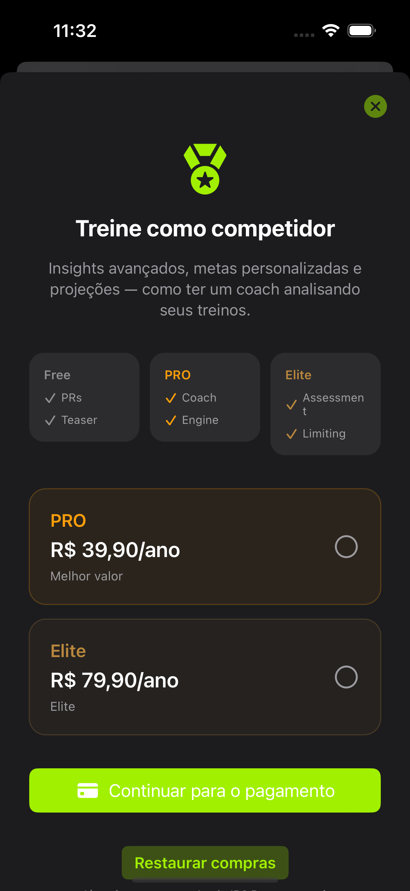

# Review — Paywall (3 variantes CPR-014)

Sheet com **mais respiro**. **Produção: B** (escolhida). Flag de review: `UITEST_PAYWALL_VARIANT=a|b|c`.

```bash
export CROSSFITPR_DOCS_ROOT="$(pwd)/docs"
xcodebuild test -scheme CrossfitPR -destination 'platform=iOS Simulator,name=iPhone 14 Pro' \
  -only-testing:CrossfitPRUITests/ReadmeScreenshotsUITests/testCapturePaywallVariants
```

## A — Hero + 2 cards anuais


Headline curta · card PRO anual · card Elite anual · 3 bullets · CTA. Mensal só como link discreto.

## B — Passos


Badge competidor · escolher PRO/Elite · Mensal/Anual · preço grande · CTA. Máximo respiro.

## C — Compare leve



3 chips Free/PRO/Elite · 2 cards de preço · CTA.

---

**Status:** B em produção (`PROUpgradeLayoutVariant.current` → `.b`). A e C ficam só para captura/review via flag.
