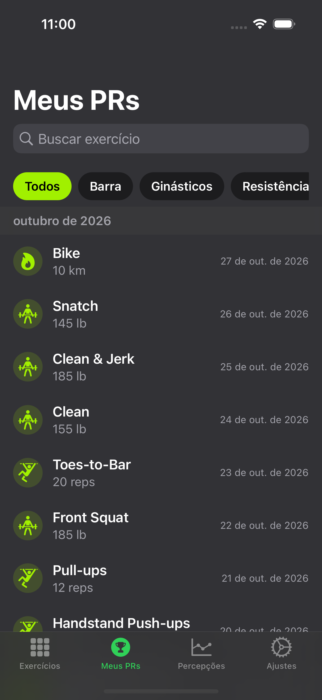
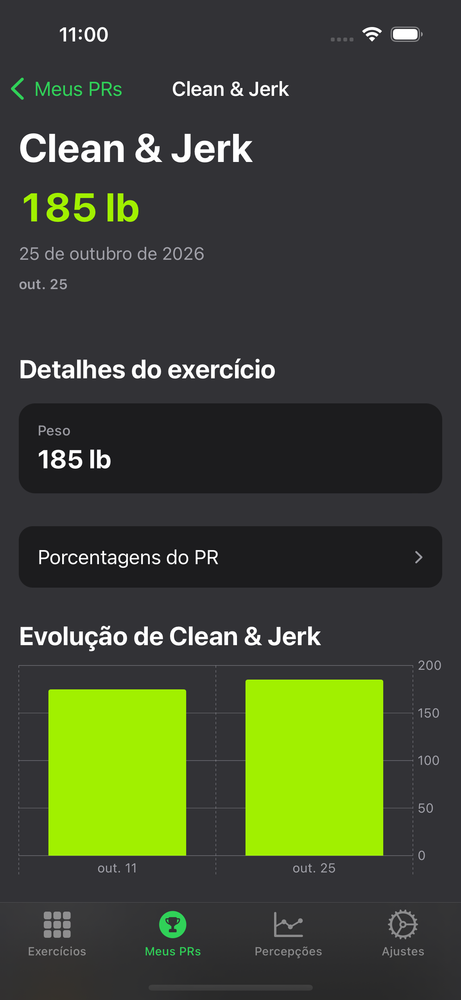
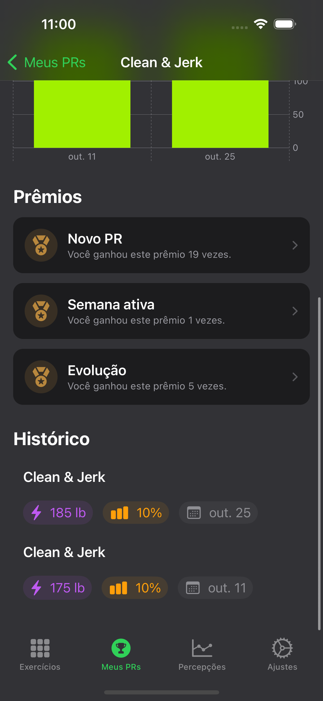
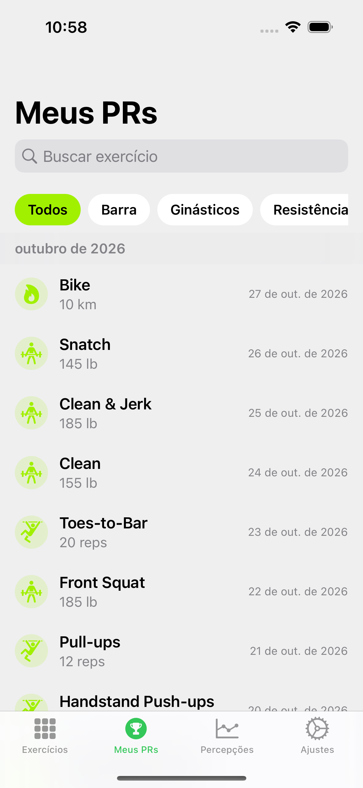
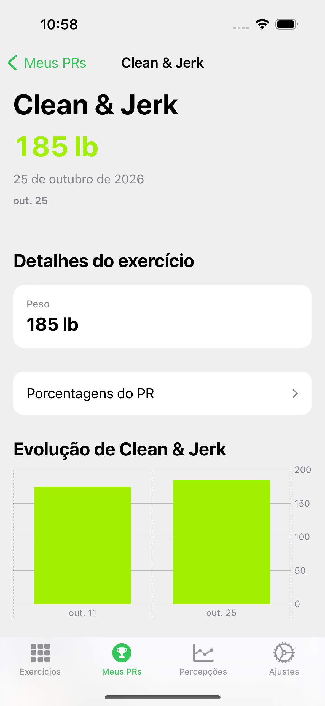
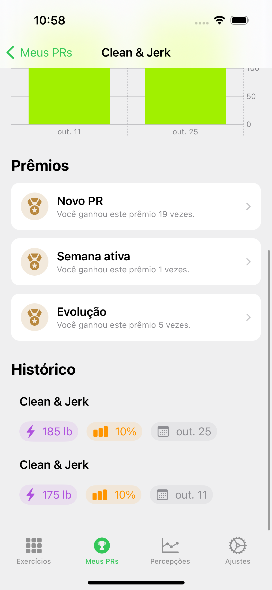

# Review visual — Meus PRs Fitness (CPR-013)

Refs de design: `docs/screenshots/design-refs/`.

## Light / Dark

| Aparência | Lista | Detalhe topo | Detalhe meio | Detalhe fim |
|-----------|-------|--------------|--------------|-------------|
| Light |  |  |  |  |
| Dark |  |  |  |  |

## Checklist

1. Chips de categoria abaixo da busca; mês sticky
2. Detalhe: local, valor, data, fonte Watch, clima, grid 2 col com respiro
3. Seção Prêmios + sheet
4. Dark mode legível (texto / lima / medalha)
