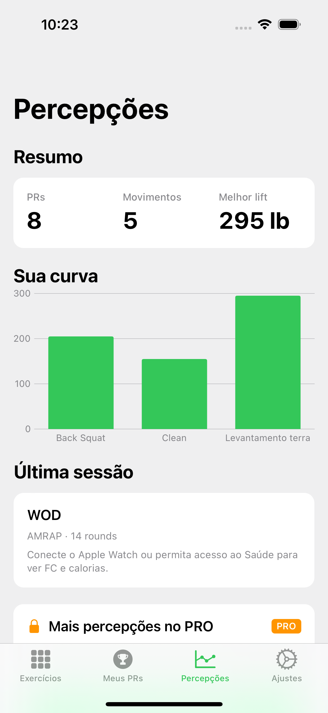
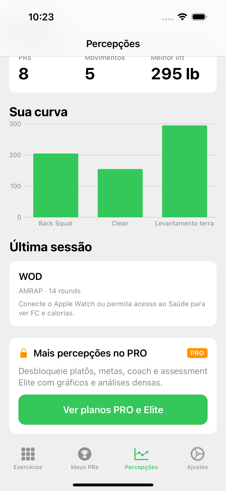
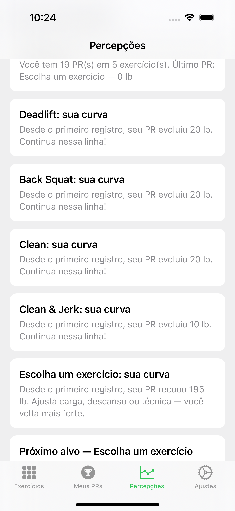
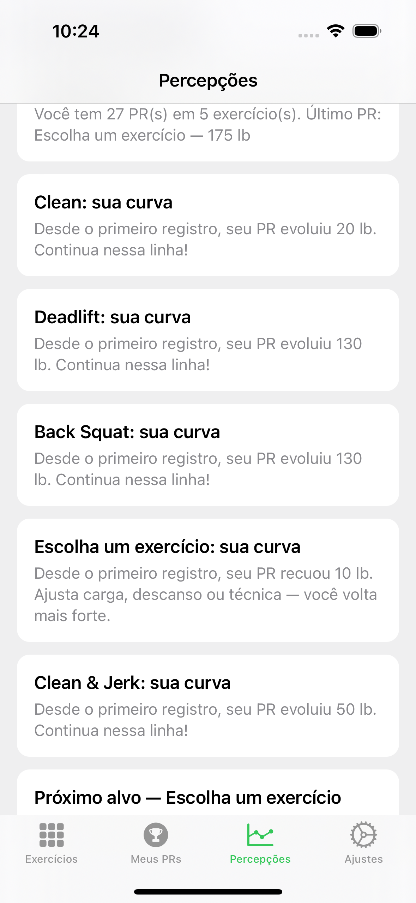

# Review visual — Free / PRO / Elite (com dados)

Galeria gerada por `ReadmeScreenshotsUITests.testCaptureTierScreenGallery`.

```bash
./scripts/generate-xcodeproj.sh
./scripts/configure-spm-xcode14.sh   # Xcode 14.2
export CROSSFITPR_DOCS_ROOT="$(pwd)/docs"
xcodebuild test -scheme CrossfitPR -destination 'platform=iOS Simulator,name=iPhone 14 Pro' \
  -only-testing:CrossfitPRUITests/ReadmeScreenshotsUITests/testCaptureTierScreenGallery
```

Seeds: Free=`freeTeaser`, PRO=`proRich`, Elite=`eliteRich`.

## Free

| Tela | Preview |
|------|---------|
| Exercícios |  |
| Meus PRs |  |
| Detalhe do PR |  |
| Percepções (topo) |  |
| Percepções (meio) |  |
| Percepções (fim) |  |
| Ajustes |  |

## PRO

| Tela | Preview |
|------|---------|
| Exercícios |  |
| Meus PRs |  |
| Detalhe do PR |  |
| Percepções (topo) |  |
| Percepções (meio) |  |
| Percepções (fim) |  |
| Ajustes |  |

## Elite

| Tela | Preview |
|------|---------|
| Exercícios |  |
| Meus PRs |  |
| Detalhe do PR |  |
| Percepções (topo) |  |
| Percepções (meio) |  |
| Percepções (fim) |  |
| Ajustes |  |

## O que olhar

1. Free: teaser com insight real + gráfico + CTA (sem parede de vendas)
2. PRO: resumo → sessão/CAL/FC → percepções → coach → ranking
3. Elite: assessment + limiting factor além do PRO
4. PRs/Exercícios populados de forma coerente entre tiers
5. Settings reflete o tier ativo
