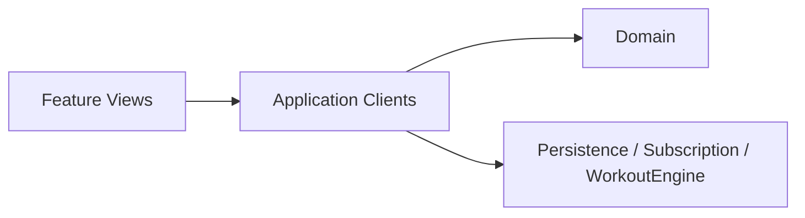

# CPR-006 — REASONS Canvas: MV SwiftUI (Norms)

**Tipo:** Feat (Norms / arquitetura de presentation)  
**Story:** `spdd/stories/CPR-006-mv-swiftui-architecture.md`  
**Analysis:** `spdd/analysis/CPR-006-mv-swiftui-architecture.md`

## R — Requirements

- Adotar **MV** como padrão oficial de presentation SwiftUI.
- Mapear guia Dimillian → Clients CrossfitPR + iOS 16 `EnvironmentObject`.
- Documentar em skills, regras Cursor e `docs/MV-ARCHITECTURE.md`.
- Migração **incremental** de views legadas; sem alterar design baseline.

**DoD:** skills/regras/docs atualizados; pelo menos um exemplo de view alinhada ao checklist MV.

## E — Entities

## A — Approach

1. Publicar skill `swiftui-mv` (adaptação Dimillian).
2. Atualizar precedência AGENTS / governance / ios-spdd skills.
3. Regra Cursor `swiftui-mv-architecture.mdc` em `**/*.swift`.
4. Refactors: reorder → extract subviews → mover lógica para clients/domain.

## S — Structure

- Norms em `.cursor/skills/swiftui-mv/`
- Doc humana: `docs/MV-ARCHITECTURE.md`
- Presentation continua em `Packages/<Feature>/`

## O — Operations

- Feature nova: SPDD → Design → **MV skill** → iOS skill → implementação.
- Refactor view: MV checklist + `/spdd-sync`.
- Code review: rejeitar ViewModels não justificados.

## N — Norms

| Norm | Regra |
|------|--------|
| N-01 | Default MV; ViewModels proibidos salvo canvas explícito |
| N-02 | Dependências compartilhadas via `@EnvironmentObject` clients |
| N-03 | Lógica de negócio em Domain/Clients/Engine, não no `body` |
| N-04 | Subviews struct > helpers `some View` grandes |
| N-05 | Strings/cores: `Strings.*`, `AppDesign.*` |
| N-06 | iOS 16+: `ObservableObject` clients até revisão de deployment |

## S — Safeguards

- Design baseline CPR-001 intacto em refactors MV.
- Domain sem SwiftUI.
- Offline-first e PRO gating inalterados salvo canvas próprio.

## Referências

- https://github.com/Dimillian/Skills/blob/main/swiftui-view-refactor/SKILL.md
- `docs/MV-ARCHITECTURE.md`
