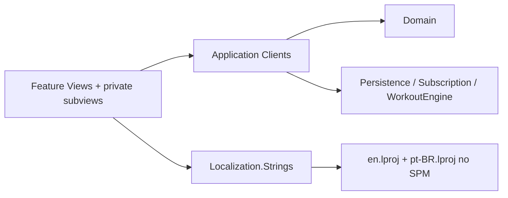

# CPR-006 — REASONS Canvas: MV SwiftUI (Norms)

**Tipo:** Feat (Norms / arquitetura de presentation)  
**Story:** `spdd/stories/CPR-006-mv-swiftui-architecture.md`  
**Analysis:** `spdd/analysis/CPR-006-mv-swiftui-architecture.md`  
**Último sync (code → prompt):** 2026-10-28 — MV ondas 1–5 (SharedUI split); CI advisory + review LLM; ver `docs/CI.md`

## R — Requirements

- Adotar **MV** como padrão oficial de presentation SwiftUI.
- Mapear guia Dimillian → Clients CrossfitPR + iOS 16 `EnvironmentObject`.
- Documentar em skills, regras Cursor e `docs/MV-ARCHITECTURE.md`.
- Migração **incremental** de views legadas; sem alterar design baseline.

**DoD:** skills/regras/docs atualizados; pelo menos um exemplo de view alinhada ao checklist MV.

*(Requirements inalterados — sync documenta estado do código, não novo escopo.)*

## E — Entities

**Presentation (SPM, MV):** views raiz orquestram; subviews `private struct` recebem dados/`Binding`/closures; sem ViewModels.

## A — Approach

1. Publicar skill `swiftui-mv` (adaptação Dimillian).
2. Atualizar precedência AGENTS / governance / ios-spdd skills.
3. Regra Cursor `swiftui-mv-architecture.mdc` em `**/*.swift`.
4. Refactors: reorder → extract subviews → mover lógica para clients/domain.
5. Copy de UI via `Strings.*` + `Localizable.strings` (en + pt-BR) no pacote `Localization`.

## S — Structure

| Área | Caminho |
|------|---------|
| Norms MV | `.cursor/skills/swiftui-mv/`, `references/mv-patterns-crossfitpr.md` |
| Doc | `docs/MV-ARCHITECTURE.md` |
| App shell | `CrossfitPR/CrossfitPRApp.swift`, `AppDependencyGraph.swift`, `RootView.swift` (wiring: `docs/APP-WIRING.md`) |
| Features | `Packages/<Feature>/Sources/.../*View.swift` |

**Views migradas (subviews extraídas, checklist MV):**

| Pacote | View raiz | Subviews (exemplos) |
|--------|-----------|---------------------|
| PROUpgrade | `PROUpgradeView` | `PROUpgradeSubviews.swift` (`PROUpgradePurchaseContent`, overlay, …) |
| Insights | `WorkoutInsightsView` | `WorkoutInsightsTierContent` |
| Insights | `InsightsTeaserView` | `InsightsTeaserEmptySection`, `InsightsTeaserCardSection`, … |
| Insights | `InsightsViewPRO` | `InsightsViewPROContent`, `InsightsViewPROChartSection`, … |
| PRHistory | `NewPRRecordView` | `NewPRRecordGroupFields`, `NewPRRecordSaveBar`, … |
| PRHistory | `PRHistoriesListView` | `PRHistoriesListContent`, estados loading/empty/list |
| RecordDetail | `RecordDetailView` | `RecordDetailMaxRecordHeader`, `RecordDetailEvolutionSection`, … |
| Settings | `SettingsView` | `SettingsNotificationSection`, `SettingsProSection`, … |
| Categories | `CategoryListView` | `CategoryListScrollContent`, `CategoryListTipHeader` |
| Onboarding | `OnboardingView` | `OnboardingFeatureList`, `OnboardingCompleteButton` |
| Launch | `LaunchView` | `LaunchOfflineContent` |
| Launch | `LaunchScreenView` | `LaunchScreenLogo` + `applyLaunchAnimation` |

**Legado (fora do target Xcode):** `CrossfitPR/Views/`, `CrossfitPR/Insights/`, etc. — ver `docs/LEGACY-CROSSFITPR-VIEWS.md`.

## O — Operations

- Feature nova: SPDD → Design → **MV skill** → iOS skill → implementação.
- Refactor view: MV checklist + `/spdd-sync` (este canvas).
- Code review: rejeitar ViewModels não justificados; PR workflow `pr-architecture-review.yml` (advisory) + scripts `scripts/architecture/*`.
- **Localização:** novas strings em `Packages/Localization/Resources/{en,pt-BR}.lproj/Localizable.strings` + API `Strings.*`; idioma segue preferência do sistema (`NSLocalizedString` + `Bundle.module`).
- **Projeto app:** `knownRegions` = `en`, `pt-BR`, `Base`; `developmentRegion` = `pt-BR` (fallback).

## N — Norms

| Norm | Regra |
|------|--------|
| N-01 | Default MV; ViewModels proibidos salvo canvas explícito |
| N-02 | Dependências compartilhadas via `@EnvironmentObject` clients |
| N-03 | Lógica de negócio em Domain/Clients/Engine, não no `body` |
| N-04 | Subviews struct > helpers `some View` grandes |
| N-05 | Strings/cores: `Strings.*`, `AppDesign.*` — **sem copy hardcoded** em Packages |
| N-06 | iOS 16+: `ObservableObject` clients até revisão de deployment |
| N-07 | Idiomas iniciais: **inglês (en)** e **português Brasil (pt-BR)** via SPM Localization |

## S — Safeguards

- Design baseline CPR-001 intacto em refactors MV.
- Domain sem SwiftUI.
- Offline-first e PRO gating inalterados salvo canvas próprio.

## Referências

- https://github.com/Dimillian/Skills/blob/main/swiftui-view-refactor/SKILL.md
- `docs/MV-ARCHITECTURE.md`
- `docs/LOCALIZATION.md`
- `docs/LEGACY-CROSSFITPR-VIEWS.md`
