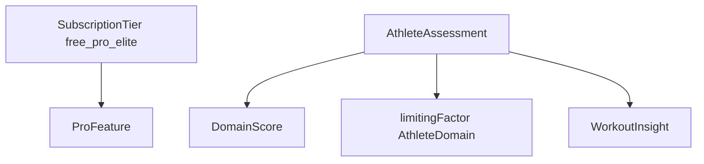

# CPR-008 — REASONS Canvas: Tier Elite

**Story:** `spdd/stories/CPR-008-elite-tier.md`  
**Analysis:** `spdd/analysis/CPR-008-elite-tier.md`  
**Design:** `spdd/prompt/CPR-008-20261028-[Design]-elite-tier-ui.md`  
**Personas:** `.cursor/skills/crossfit-athlete-personas/`

## R — Requirements

- Tier acima de PRO para persona Compete / Freedom avançado.
- Paywall e entitlement StoreKit documentados (fase UI).
- Budget de tokens Elite separado em `TokenBudgetPolicy`.
- UI premium distinta (Design skill) — fase UI.
- **Athlete Assessment** por domínio (strength / olympic / gymnastics / engine).
- **Limiting factor** derivado do assessment; teaser no PRO.
- Engine calibra com heurísticas de cobertura/progresso (referência elite); densidade gated por tier.
- Não shippar programming diário.

### DoD (fase Domain + Engine)

- [x] `SubscriptionTier.elite` + `ProFeature` elite-only + testes de gating
- [x] `AthleteAssessmentService` (Domain) + insights no `WorkoutEngine`
- [x] Categorias `eliteAssessment` / `eliteLimitingFactor` / `eliteTeaser`
- [x] `TokenBudgetPolicy.limits(for: .elite, …)`
- [x] Strings `Strings.Engine` / Elite via Localizable en + pt-BR
- [ ] Free/PRO behavior regressão verde (CI `swift test` Domain/WorkoutEngine — Xcode recente)

## E — Entities

- `SubscriptionTier.elite`
- `ProFeature.athleteAssessment`, `.limitingFactorAnalysis` (`isEliteOnly`)
- `AthleteDomain`, `DomainScore`, `AthleteAssessment`
- `WorkoutInsight.Category`: `eliteAssessment`, `eliteLimitingFactor`, `eliteTeaser`
- Extensões de coach: mesmo schema CPR-007, budget maior

## A — Approach

1. Domain: tier + ProFeatures + `AthleteAssessmentService`.
2. WorkoutEngine: gerar assessment/limiting para Elite; teaser para PRO; ignore Free.
3. Coaching: `TokenBudgetPolicy` Elite (14 movements / 1536 in / 180d no builder quando Elite — fase 2 wiring).
4. ~~Design canvas → tokens → PROUpgrade multi-plano + cards Insights.~~
5. ~~StoreKit produto Elite + `SubscriptionClient` resolve `.elite`.~~ (Connect: criar produtos reais na App Store)

## S — Structure (SPM)

| Pacote | Mudança |
|--------|---------|
| Domain | Tier, ProFeature, assessment types + service |
| WorkoutEngine | Insights Elite / teaser |
| Coaching | TokenBudgetPolicy.elite |
| Localization | Strings assessment / limiting / teaser Elite |
| Insights / PROUpgrade | Fase UI (Design) |
| Subscription | Fase StoreKit |

## O — Operations

- `AthleteAssessmentService.assess(records:) -> AthleteAssessment`
- `WorkoutEngine.generateInsights(..., tier: .elite)` inclui assessment + limiting
- `SubscriptionTier.canAccess` — Elite all; PRO !eliteOnly; Free basic

## N — Norms

- MV + clients; sem ViewModels.
- Copy `Strings.*`; sem hardcode.
- Personas skill: Compete primary; não guilt streaks; stimulus/limiting ensinam *por quê*.
- Não shippar Elite UI sem Design aprovado.
- Não quebrar PRO (backward compatible entitlements).

## S — Safeguards

- Domain sem SwiftUI.
- Teaser Elite no PRO não vaza scores completos.
- Watch fora (CPR-009).
- Offline-first inalterado.
