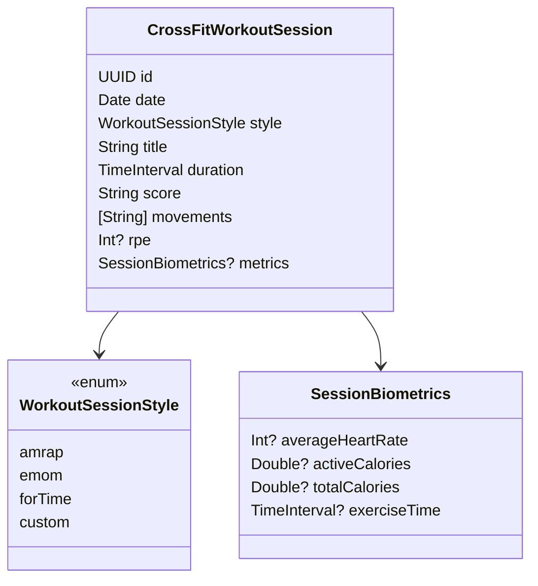

# CPR-012 — REASONS Canvas: CrossFit workout session

**Story:** `spdd/stories/CPR-012-crossfit-workout-session.md`  
**Analysis:** `spdd/analysis/CPR-012-crossfit-workout-session.md`

## R — Requirements

Entidade de sessão WOD/metcon com biometrics opcionais; persistência; client; consumo Insights/coach; fixtures.

## E — Entities

## A — Approach

1. Domain types + repository port  
2. SwiftData entity + PersistenceFactory  
3. WorkoutSessionClient  
4. Insights section + CoachingContextBuilder  
5. Fixtures

## S — Structure

Domain, Persistence, Application, Insights, Coaching, Localization

## O — Operations

`fetchAll`, `save`, `delete` no port; client `@Published sessions`

## N — Norms

MV; Sendable Domain; sem ViewModels

## S — Safeguards

Não é programming diário; sync CloudKit best-effort futuro
